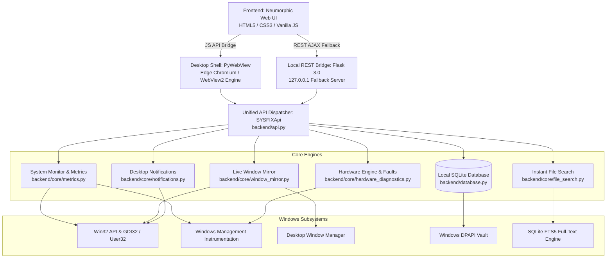

# TERMINAL BOARD

### ONE CENTER. EVERY CONTROL.

<p align="center">
  <strong>Your workspace. Your commands. Your control.</strong><br>
  A unified Windows desktop utility integrating System Monitoring, Instant File Search, Live Window Mirroring, Hardware Diagnostics, and Background Desktop Notifications into one centralized application.
</p>

<p align="center">
  
  
  
  
  
</p>

---

## 1. Project Overview

**TERMINAL BOARD** is a unified, high-performance Windows desktop utility designed to centralize everyday system operations into a single cohesive interface.

Traditionally, power users, developers, and system administrators juggle between Task Manager, File Explorer, Windows Settings, third-party file search tools (like Everything), screen mirroring apps, and notification dashboards. Terminal Board consolidates these workflows into a lightweight, modular desktop application built on a modern **Dark Neumorphic** interface powered by Python and PyWebView.

### Core Philosophy
- **Real Measurements, Zero Fabrication:** All telemetry—from CPU logical core loads to disk health counters and event logs—is acquired directly from authentic Windows kernel, WMI, and Win32 subsystems.
- **Honest Telemetry:** When low-level sensors (such as ACPI thermal zones or SMART reliability counters) require administrative elevation, Terminal Board clearly notes *"Telemetry restricted / Requires Administrator"* rather than guessing or fabricating numbers.
- **Safe & Non-Destructive:** Safe read-only inspection by default. All administrative interventions (e.g., DNS flush, process termination, temp file cleanup) require **explicit user confirmation**.
- **100% Offline & Private:** Zero external cloud dependencies, zero paid APIs, zero tracking telemetry. Sensitive credentials (such as SMTP tokens for scheduled reports) are protected via the Windows Data Protection API (**DPAPI**).

---

## 2. Core Capabilities

### 2.1 System Monitoring & Resource Telemetry
- **CPU Utilization:** Real-time aggregate load and per-core utilization breakdown across all logical cores.
- **RAM Architecture:** Physical RAM capacity, currently active memory, available memory, and pagefile swap usage.
- **Storage & Disk Telemetry:** Physical drive auto-detection (NVMe, SATA SSD, HDD), volume capacities, active free space, and SMART status.
- **Hardware Inventory:** Complete hardware component discovery across Processor, Motherboard, Memory DIMMs, GPU, Battery, and Network Adapters.
- **Background Telemetry Worker:** Asynchronous sampling loop providing smooth UI updates without thread contention.

### 2.2 Instant File Search (Everything-Style Engine)
- **High-Performance Crawling:** Multithreaded crawler utilizing optimized filesystem traversal (`os.scandir`).
- **SQLite FTS5 Full-Text Indexing:** Sub-millisecond incremental querying across file names and directory paths.
- **Advanced Filtering:** Filter by filename, extension, path, minimum/maximum file size, and modified date ranges.
- **Safe Shell Actions:** Context-aware commands to launch files in default applications or highlight them directly inside Windows Explorer.
- **Search Cancellation & History:** Non-blocking asynchronous query workers with instant cancellation and recent search history tracking.

### 2.3 Live Window Mirror
- **Window Discovery:** Enumerates active, top-level visible application windows, filtering cloaked windows (virtual desktops / minimized store apps) and tooltips.
- **Real-Time Visual Mirroring:** High-speed frame capture utilizing Windows GDI and DWM PrintWindow (`PW_RENDERFULLCONTENT`).
- **Floating Preview Controls:** Resizable preview window, always-on-top toggle, pause/resume capability, and clean resource release on close.
- **Safe Memory Handling:** Direct GDI Device Context allocation and cleanup ensuring zero graphic memory leaks.

### 2.4 Desktop Notifications & Action Center Integration
- **Native Toast Delivery:** Dispatches genuine Windows Action Center notifications via PowerShell WinRT bridge.
- **Intelligent Deduplication:** Rate-limiting cache (3-minute debounce window) preventing notification floods during high-load events.
- **Configurable Alert Thresholds:** Customizable warning triggers for CPU, RAM, Disk space, and hardware driver alerts.
- **Persistent Notification Log:** Complete local SQLite history of dispatched alerts with acknowledge/dismiss actions.

### 2.5 Hardware Diagnostics & Fault Correlation Engine
- **Pre-Emptive Diagnostics:** Active user-space instruction validation, RAM heap bit-pattern integrity testing, and non-destructive disk read latency profiling.
- **Hardware Fault Correlation:** Correlates hardware inventory items, Windows WHEA error events, and diagnostic test anomalies to detect impending hardware failure.
- **Multi-Format Export:** Generates 20-section diagnostic reports in JSON, formatted Plain Text, and standalone HTML.

### 2.6 Background Email Reporting & Automation
- **Scheduled System Reports:** Integrated with Windows Task Scheduler to compile and dispatch daily diagnostic digests.
- **DPAPI Vault Security:** SMTP server credentials encrypted locally via Windows `CryptProtectData`.

---

## 3. System Architecture



---

## 4. Technology Stack

| Layer | Component | Description |
| :--- | :--- | :--- |
| **Runtime Environment** | Python 3.10+ | Primary application runtime for backend logic and Windows integration. |
| **Desktop Shell** | PyWebView 5.0+ | Lightweight native desktop window leveraging Windows Edge WebView2. |
| **Web Framework** | Flask 3.0+ & Flask-CORS | Fallback local REST API and HTTP browser debugging server. |
| **Low-Level APIs** | `pywin32`, `ctypes`, `WMI` | Direct interfacing with User32, GDI32, Win32EvtLog, DWM, and WMI classes. |
| **System Telemetry** | `psutil` + Safe Wrapper | Cross-platform metrics wrapped with fallback guards for permission isolation. |
| **Image Processing** | Pillow (PIL) | High-speed frame resizing, buffer decoding, and JPEG encoding for Window Mirror. |
| **Local Storage** | SQLite3 + FTS5 | Local database for historical metrics, alerts, settings, and full-text file search. |
| **Security** | Windows DPAPI | Native credential encryption via Windows cryptographic APIs. |
| **User Interface** | Vanilla HTML5 / CSS3 / JS | Dark Neumorphic styling, zero bulky web frameworks, sub-100ms UI responsiveness. |
| **Testing** | Pytest 8.0+ | Automated test suite with 187 comprehensive test cases. |
| **Packaging** | PyInstaller 6.0+ & Inno Setup | Standalone Windows executable and standard setup installer. |

---

## 5. Repository Structure

```
TERMINAL-BOARD/
│
├── .gitignore                      # Comprehensive Git exclusion rules
├── LICENSE.txt                     # MIT Open-Source License
├── README.md                       # Master Documentation
├── Terminal Board.png              # Application UI Screenshot & Branding
├── WINPE_RECOVERY_GUIDE.md         # Pre-boot WinPE disaster recovery guide
│
├── app.py                          # Main Desktop Entry Point
├── recovery_cli.py                 # Pure console triage entry point for WinPE
├── requirements.txt                # Production and development dependencies
│
├── backend/
│   ├── __init__.py                 # Backend package marker
│   ├── api.py                      # Unified PyWebView & Flask REST API dispatcher
│   ├── database.py                 # SQLite schema, migrations, and settings storage
│   ├── monitor.py                  # Background telemetry worker thread
│   └── core/
│       ├── __init__.py             # Core package marker
│       ├── alerts.py               # Alert evaluation, threshold breaches & toasts
│       ├── credential_store.py     # Windows DPAPI credential encryption vault
│       ├── cryptic.py              # Cryptic string sanitizer & privacy anonymizer
│       ├── diagnostics.py          # Diagnostic rule engine & safe remediation
│       ├── driver_alerts.py        # Driver fault correlation & alert generation
│       ├── driver_inventory.py     # Windows PnP driver catalog & hardware IDs
│       ├── email_reports.py        # 7:00 PM daily system diagnostic email digest
│       ├── email_service.py        # SMTP client, TLS verification & retry queue
│       ├── events.py               # Windows Event Log query engine (win32evtlog)
│       ├── fault_correlation.py    # Cross-layer hardware fault correlation engine
│       ├── file_search.py          # FTS5 instant file search & crawler engine
│       ├── hardware_diagnostics.py # Active hardware stress & integrity tests
│       ├── hardware_inventory.py   # Complete WMI hardware component discovery
│       ├── hardware_report.py      # 20-section report builder (JSON/TXT/HTML)
│       ├── license_audit.py        # Software license detection & audit scanner
│       ├── license_expiry.py       # Expiry date evaluation & license tracking
│       ├── metrics.py              # CPU, RAM, Disk, GPU & Battery collectors
│       ├── network.py              # Interface diagnostics, latency & port scanner
│       ├── notifications.py        # Desktop toast delivery & rate limiter
│       ├── office_licensing.py     # Microsoft Office OSPP license inspector
│       ├── safe_psutil.py          # Crash-safe psutil wrapper
│       ├── scheduler.py            # Windows Task Scheduler automation
│       ├── software.py             # Installed software registry discovery
│       ├── startup.py              # Windows Run registry configuration
│       ├── storage.py              # Physical storage, NVMe & SMART diagnostics
│       ├── subproc.py              # Safe subprocess execution & cleanup
│       └── window_mirror.py        # Live window discovery & GDI frame capture
│
├── frontend/
│   ├── index.html                  # Neumorphic single-page desktop dashboard
│   ├── assets/                     # Frontend logos, icons, and emblems
│   ├── css/
│   │   └── neumorphic.css          # Restrained dual-shadow dark neumorphic stylesheet
│   └── js/
│       ├── app.js                  # Main UI coordinator, views & event bindings
│       ├── charts.js               # Lightweight SVG sparkline and chart renderer
│       └── icons.js                # Embedded SVG vector icon library
│
├── assets/                         # High-resolution application icons and master assets
├── docs/                           # Extended technical context & architecture notes
├── tests/                          # 23 automated test suites (187 test cases)
└── winpe/                          # Scripts and configurations for WinPE boot ISO
```

---

## 6. Installation & Execution

### Prerequisites
- Windows 10 or Windows 11 (64-bit recommended)
- Python 3.10 or higher
- PowerShell 5.1+ (included natively with Windows)

### 1. Clone Repository
```bash
git clone https://github.com/KarthikeyanSA369/TERMINAL-BOARD.git
cd TERMINAL-BOARD
```

### 2. Create and Activate Virtual Environment
```powershell
python -m venv venv
.\venv\Scripts\activate
```

### 3. Install Dependencies
```powershell
pip install -r requirements.txt
```

### 4. Launch Application
```powershell
# Standard Desktop Window (PyWebView)
python app.py

# Local Browser / Web Mode (Accessible via http://127.0.0.1:5055)
python app.py --web

# Standalone CLI Hardware Diagnostic Scan
python app.py --hardware-scan --export-report all
```

---

## 7. Testing & Quality Assurance

The project contains a comprehensive automated test suite covering all core engines, subsystems, and APIs.

```powershell
# Execute the entire test suite
python -m pytest tests

# Run tests with verbose output
python -m pytest tests -v

# Run specific functional test suites
python -m pytest tests/test_window_mirror.py
python -m pytest tests/test_file_search.py
python -m pytest tests/test_notifications.py
python -m pytest tests/test_hardware_engine.py
```

### Test Suite Verification Status
- **Total Tests:** 187
- **Passed:** 187
- **Failed:** 0
- **Pass Rate:** 100%

---

## 8. Build & Packaging

To compile a standalone, zero-dependency Windows desktop executable:

```powershell
# Build standalone directory bundle using PyInstaller
python build_exe.py

# Or run the batch packaging script
.\build_exe.bat
```

The compiled binaries will be output to the `dist/TERMINAL_BOARD/` directory.

To create an Inno Setup installer package, compile `installer.iss` using Inno Setup 6+.

---

## 9. Security & Privacy

Terminal Board adheres to strict security standards:
- **Zero Remote Telemetry:** No user data, system profiles, or telemetry metrics are transmitted to any cloud or third-party servers.
- **Windows DPAPI Vault:** Credentials entered by the user (such as SMTP app passwords for report delivery) are encrypted on disk using the current user's DPAPI key (`CryptProtectData`), preventing offline extraction.
- **Explicit Confirmation for Actions:** Remediation tools (DNS cache flush, temporary file purging, process termination) cannot run autonomously; each requires explicit interactive approval.
- **Subprocess Isolation:** Subprocess execution utilizes strict timeout parameters, parameter escaping, and child process process-group tracking to avoid hanging tasks or resource leaks.

---

## 10. License

This project is licensed under the **MIT License**. See the [LICENSE.txt](file:///e:/SYSFIX/LICENSE.txt) file for details.

---

<div align="center">
  <strong>TERMINAL BOARD — ONE CENTER. EVERY CONTROL.</strong><br>
  Built with precision for Windows power users and administrators.
</div>
